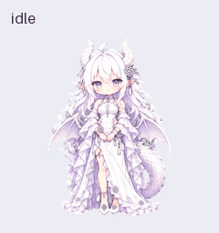
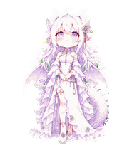

# GPT-Pet · 霜璃

以银白龙娘「霜璃」为主题的 ChatGPT Pets 动画素材项目。完整保留了参考图、基础形象、生成提示、动作源图、透明精灵图、动画预览与质量检查记录。

角色采用日系 Q 版比例：银白长发、紫色眼睛、双龙角、尖耳、淡紫薄翼、蓬松龙尾，搭配白色长裙、紫灰褶边和银色花结饰品。

当前版本已修复转头和左右移动时的侧脸：改用双眼可见的四分之三转头，保留远眼透视，缩短鼻尖和下巴，避免面颊与下颌向前拉长。两组移动和十六方向共重绘 32 帧，其余七组状态的 41 帧逐像素保持不变。源图、前后对比和完整验证见 [侧脸修复记录](Pets/shuangli/revisions/face-shape-v4/README.md)。

[打开转头与移动对比页](Pets/shuangli/revisions/face-shape-v4/experience-preview.html)，可切换动作、底色及显示大小；这些控制项仅用于检查素材。





## 项目内容

- **9 组动作**：待机、向右移动、向左移动、挥手、跳跃、失落反应、等待回应、专注工作、检查结果。
- **16 个视线方向**：按照屏幕坐标，从正上方开始，以 22.5° 为间隔顺时针排列。
- **73 个有效帧**：57 个标准动作帧，加上 16 个视线帧。
- **透明 v2 精灵图**：`1536 × 2288` 像素，8 列 × 11 行，每格 `192 × 208` 像素。
- **制作记录**：原始参考、布局引导、提示词、修订版本、逐帧检查和三位独立评审的视线盲检。

本仓库是动画资产与制作资料的归档。图像生成通过 Codex 的 imagegen 能力完成，合成与质量检查使用 Pets 技能附带的脚本。仓库中的预览工具可以直接读取成品精灵图，不需要图像生成服务。

## 下载与查看

可以直接打开以下本地文件：

| 文件 | 用途 |
| --- | --- |
| [最终透明精灵图](Pets/shuangli/final/spritesheet-extended.png) | 用于 Pets 的 v2 动画资产 |
| [全部动作 GIF](Pets/shuangli/previews/all-states.gif) | 快速浏览九组标准动作 |
| [全部动作 MP4](Pets/shuangli/previews/all-states.mp4) | 视频播放器预览 |
| [视线循环 GIF](Pets/shuangli/previews/look-loop.gif) | 查看十六方向的完整循环 |
| [待机 → 跳跃 → 待机](Pets/shuangli/previews/idle-jump-idle.gif) | 检查离地、落地与动作衔接 |
| [全部帧检查图](Pets/shuangli/qa/contact-sheet-final.png) | 查看每个有效格与透明空白格 |
| [带标签的方向检查图](Pets/shuangli/qa/direction-sheet.png) | 对照视线方向与头部细节 |

## 精灵图规格

最终文件为带 alpha 通道的 RGBA PNG。坐标从左上角开始，行和列均从 0 计数。每行的有效帧从最左侧依次排列，剩余格全部透明。

| 行 | 状态 | 有效帧数 | 动作含义 |
| ---: | --- | ---: | --- |
| 0 | `idle` | 6 | 呼吸、眨眼与轻微摆动 |
| 1 | `running-right` | 8 | 朝屏幕右侧移动，交替步态 |
| 2 | `running-left` | 8 | 朝屏幕左侧移动，交替步态 |
| 3 | `waving` | 4 | 通过手部动作打招呼 |
| 4 | `jumping` | 5 | 蓄力、上升、腾空、下降、落地 |
| 5 | `failed` | 8 | 低头、失落表情与恢复 |
| 6 | `waiting` | 6 | 双手张掌、期待眼神与轻微歪头 |
| 7 | `running` | 6 | 站定思考与专注工作 |
| 8 | `review` | 6 | 向下侧视、轻点头后回正 |
| 9 | `look-row-9` | 8 | 000° 至 157.5° 的右半圈视线 |
| 10 | `look-row-10` | 8 | 180° 至 337.5° 的左半圈视线 |

`running` 表示正在处理任务；`running-right` 和 `running-left` 表示角色的左右移动。

单格的裁切区域：

```python
left = column * 192
top = row * 208
frame = atlas.crop((left, top, left + 192, top + 208))
```

### 十六方向顺序

左右始终指屏幕左右。000° 为抬头向上看，180° 为低头向下看；正面休息姿势由待机帧提供。

| 列 | 行 9 | 方向 | 行 10 | 方向 |
| ---: | ---: | --- | ---: | --- |
| 0 | 000° | 上 | 180° | 下 |
| 1 | 022.5° | 右上 | 202.5° | 左下 |
| 2 | 045° | 右上 | 225° | 左下 |
| 3 | 067.5° | 右上 | 247.5° | 左下 |
| 4 | 090° | 右 | 270° | 左 |
| 5 | 112.5° | 右下 | 292.5° | 左上 |
| 6 | 135° | 右下 | 315° | 左上 |
| 7 | 157.5° | 右下 | 337.5° | 左上 |

视线由头颈转动和眼睛协调表达，裙摆、脚与下半身保持锚定。发饰固定在角色的解剖左侧，右转时由头部遮挡，左转时保留在可见近侧。

## 目录结构

```text
GPT-Pet/
├── README.md
├── requirements.txt
└── Pets/shuangli/
    ├── README.md                   # 角色制作记录与修订说明
    ├── request-brief.md            # 设计需求与参考说明
    ├── pet_request.json            # 角色、布局与风格配置
    ├── imagegen-jobs.json          # 生成作业与输入引用
    ├── references/                # 三张原始参考、基础形象与布局引导
    ├── prompts/                   # 基础形象、动作、视线和修订提示
    ├── decoded/                   # 生成的动作源图与保留的修订版本
    ├── frames/                    # 标准动作提取帧，尚未做最终边缘清理
    ├── final/                     # 最终透明精灵图与尺寸/字节验证报告
    ├── previews/                  # 从最终精灵图导出的 GIF、MP4 和逐帧图
    └── qa/                        # 质量报告、盲检、检查图与预览工具
```

`decoded/`、`frames/`、`prompts/`、`references/` 及根部作业记录保留早期制作过程；当前侧脸修复的源图、提示与检查记录位于 `revisions/face-shape-v4/run/`；上轮其余状态制作记录位于 `revisions/small-native-v3/run/`。被否决版本没有上传。使用时以 `final/spritesheet-extended.png` 为准，版本索引为 `current-version.json`；`previews/final-frames/` 是当前最终边缘清理后重新裁切的帧。

## 在本地重新导出预览

需要 Python 3.10 或更新版本。安装依赖后，预览工具可跨平台运行，不依赖本机 Codex 的安装路径。

```bash
python3 -m venv .venv
source .venv/bin/activate
python -m pip install -r requirements.txt
python Pets/shuangli/qa/render_final_previews.py --output-dir output/previews
```

Windows PowerShell 中激活虚拟环境的命令为：

```powershell
.venv\Scripts\Activate.ps1
```

工具默认读取本仓库的最终精灵图，输出九个状态 GIF、全部动作 GIF/MP4、十六方向视线 GIF、待机跳跃衔接 GIF、四帧检查图以及最终裁切帧。

也可以指定另一份兼容的精灵图：

```bash
python Pets/shuangli/qa/render_final_previews.py path/to/spritesheet.png --output-dir output/custom-preview
```

仅需要 GIF 时可以跳过视频编码：

```bash
python Pets/shuangli/qa/render_final_previews.py --output-dir output/previews --skip-mp4
```

## 制作与修订流程

1. 整理三张角色参考，确定 Q 版比例、配色、衣饰、龙翼、龙尾和非对称发饰。
2. 生成一张基础形象，作为后续所有动作的身份参考。
3. 分别生成九组标准动作，立即提取完整姿势并检查帧数、连通性、轮廓、比例和落点。
4. 合成标准动作精灵图，查看逐帧检查图和循环预览。
5. 确认上下左右四个视线基准，再依次生成两组完整的八方向视线。
6. 对视线进行共享比例与基线登记，检查两个半圈的边界衔接。
7. 合成 v2 精灵图，执行一次最终绿边清理，验证透明度、布局和精确文件字节。
8. 进行方向语义检查、连续性检查和三位独立评审的随机 A/B 盲检。
9. 从最终编码精灵图导出动画，完成 Pets 文件预检后创建或更新宠物；本次保持现有宠物 ID 和活动选择，下载保存版本核对像素。

生成过程使用绿色 `#00FF00` 作为抠图背景，因此源图可能仍带绿底。最终精灵图及成品预览使用透明背景。新的角色或视觉修订仍需要 imagegen 与 Pets 技能；本仓库没有复制这些外部生成服务或完整合成工具。

## 验证结果

| 检查 | 记录 |
| --- | --- |
| 精灵图结构与透明格 | [validation-extended.json](Pets/shuangli/final/validation-extended.json) |
| 最终边缘去色 | [chroma-despill-extended.json](Pets/shuangli/qa/chroma-despill-extended.json) |
| 标准动作帧检查 | [review.json](Pets/shuangli/qa/review.json) |
| 十六方向语义检查 | [direction-semantics.json](Pets/shuangli/qa/direction-semantics.json) |
| 相邻方向连续性 | [look-continuity.json](Pets/shuangli/qa/look-continuity.json) |
| 三位独立评审的盲检 | [blind-validation.json](Pets/shuangli/qa/blind-validation.json) |
| 最终综合质量检查 | [pet-quality.json](Pets/shuangli/qa/pet-quality.json) |
| Pets 文件预检 | [pets-preflight.json](Pets/shuangli/qa/pets-preflight.json) |
| 独立视觉复核 | [independent-final-review.json](Pets/shuangli/qa/independent-final-review.json) |
| 其他 41 帧保留验证 | [preserved-states-final.json](Pets/shuangli/qa/preserved-states-final.json) |

当前最终尺寸为 `1536 × 2288`，文件大小为 **3,538,414 字节**。最终质量检查按 alpha > 16 的可见边界测得跳跃峰值离地 **40 px**，落点与待机相同。左右移动分别绘制，保留非对称发饰的正确侧别。三位独立盲检均确认全部方向；独立视觉复核及 Pets 预检通过。

连续性检查在 `157.5° → 180°` 处有像素差异统计提示，部分行的翼下和裙边外侧留白也触发透明区域扫描提示。独立复核确认这些是角色外部的自然空隙，没有穿过身体的破洞或接缝；方向、基线、整圈衔接和两组步态通过。若干斜向角度彼此相近，保留为已复核提示，三人盲检确认全部方向轴。

成品 SHA-256：

```text
4608b7258cfd489db3d07e64128da9df03f4f852bf2d31121babc3a8bd9a9696
```

可以在克隆后核对文件：

```bash
python -c "import hashlib; from pathlib import Path; print(hashlib.sha256(Path('Pets/shuangli/final/spritesheet-extended.png').read_bytes()).hexdigest())"
```

报告记录的是本次制作完成时的实际检查结果，重新生成图像后需要重新执行对应质量检查。上传后的图像可能重新编码，已按解码后的 RGBA 逐像素核对一致，见 [保存验证](Pets/shuangli/qa/stored-verification.json)。本地制作报告可能含本机路径，账号专属的安装记录在被忽略的 `pet-record.json` 中。

## 在 Pets 中使用

将最终透明精灵图用于 Pets 创建或更新流程：先验证文件，再准备上传会话，随后创建或更新现有宠物。本次已通过插件更新原有「霜璃」，活动选择保持不变。素材归档本身不会自动安装宠物。

Pets 每格固定为 `192 × 208` 像素；现有素材接口不提供客户端帧率、插值、随机动作调度、点击任务入口、专注模式或停靠设置。本轮改善的是画面和动作表现，不把素材变更当作客户端性能提升。

## 素材与许可

原始设计参考位于 `references/reference-01.png` 至 `reference-03.png`，生成的基础形象与动作采用 imagegen。仓库目前未指定 `LICENSE`；如需转载、再分发或商用，请联系项目维护者确认使用范围。
